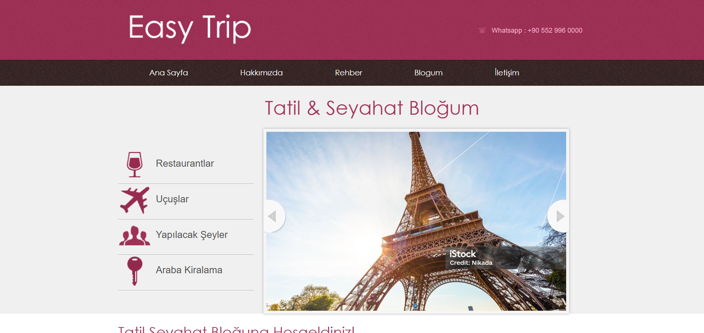
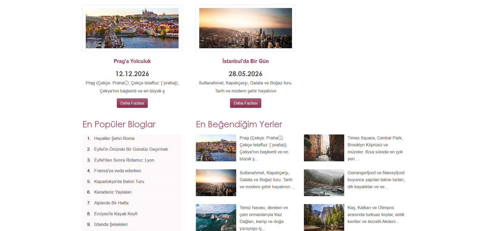
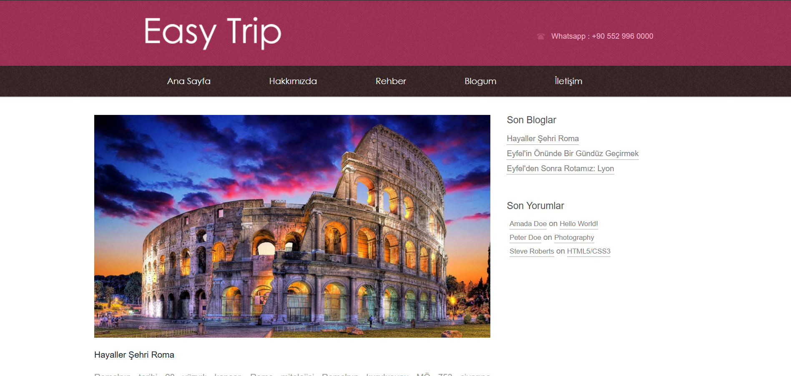
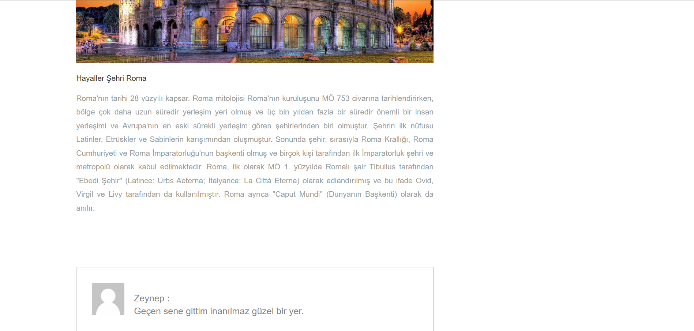
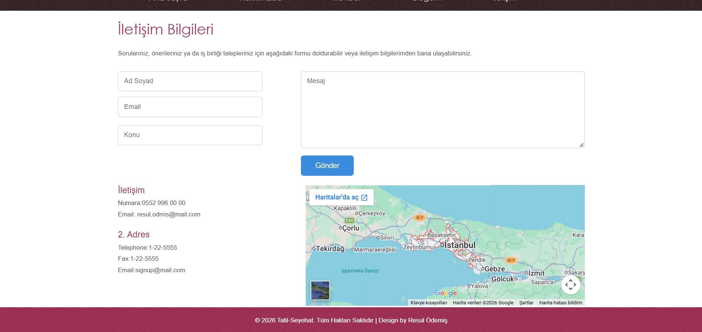
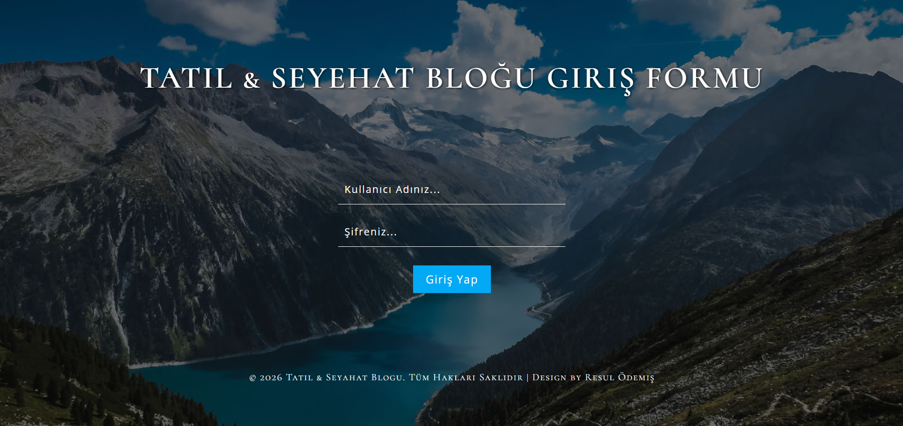
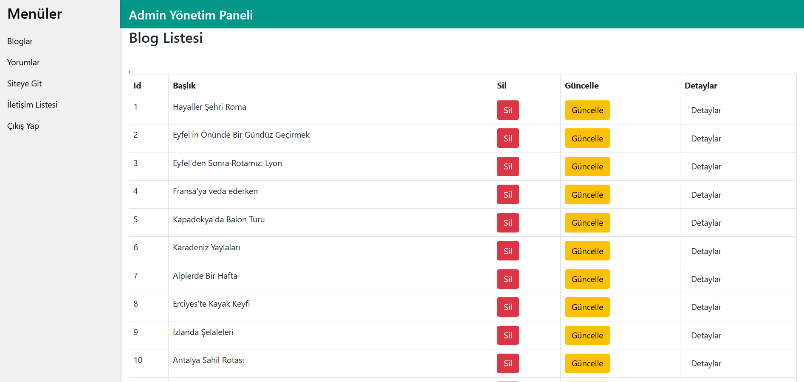
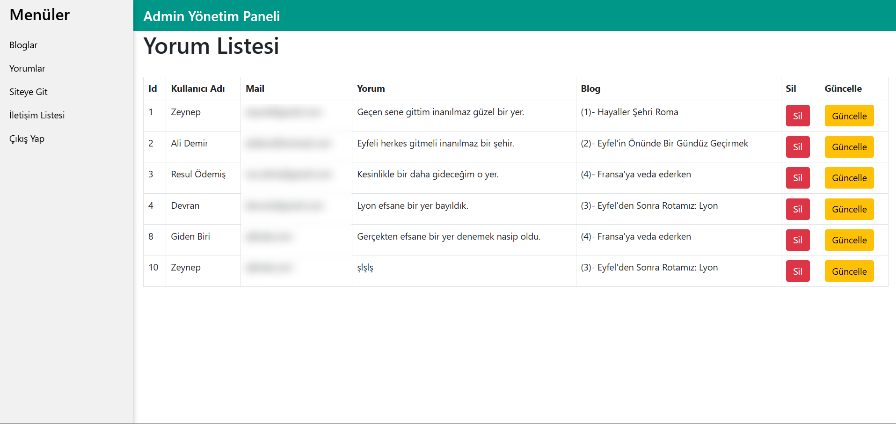
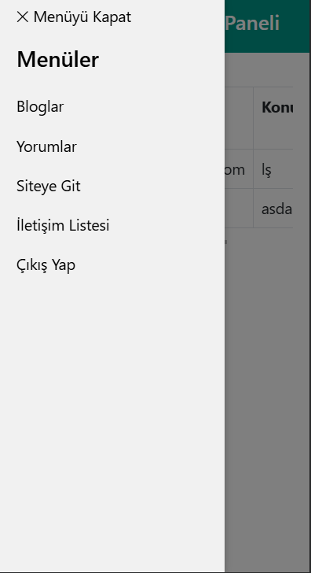

# ✈️ MVC-TravelTrip - Tatil & Seyahat Blogu

<p align="center">
  
</p>

**ASP.NET Core 8.0 MVC** ile geliştirilmiş, admin panelli bir **tatil ve seyahat blogu**. Ziyaretçiler gezi yazılarını okuyabilir, yazılara yorum yapabilir ve iletişim formu üzerinden mesaj gönderebilir. Blog yazıları, yorumlar ve gelen mesajlar **cookie tabanlı giriş** ile korunan bir yönetim panelinden yönetilir. Veriler **SQL Server** üzerinde **Entity Framework Core (Code First)** ile tutulur. Tüm arayüz Türkçedir.

<p align="center">
  
  
  
  
  
</p>

---

## 📑 İçindekiler

- [Site Özellikleri](#-site-özellikleri)
- [Yönetim Paneli](#️-yönetim-paneli)
- [Teknoloji Stack](#-teknoloji-stack)
- [Mimari](#️-mimari)
- [Veritabanı Şeması](#️-veritabanı-şeması)
- [Kurulum](#-kurulum)
- [Sayfalar ve Adresler](#-sayfalar-ve-adresler)
- [Proje Yapısı](#-proje-yapısı)
- [Kod Örnekleri](#-kod-örnekleri)
- [Eğitim Üzerine Yaptığım İyileştirmeler](#-eğitim-üzerine-yaptığım-iyileştirmeler)
- [Teşekkür](#-teşekkür)

---

## 🌐 Site Özellikleri

### 🏠 Ana Sayfa
- Blog görsellerinden oluşan **otomatik kayan slider**
- **Son bloglar** kartları (görsel, başlık, tarih, kısa açıklama)
- **En popüler bloglar** listesi ve **en beğendiğim yerler** bölümü
- Her bölüm kendi verisini çeken ayrı bir **View Component**'tir

<p align="center">
  
</p>

### 📝 Blog ve Yorumlar

<table>
  <tr>
    <td width="50%" valign="top">
      
      <p align="center"><b>Blog Listesi</b><br>Tüm gezi yazıları ve yan menüde son bloglar</p>
    </td>
    <td width="50%" valign="top">
      
      <p align="center"><b>Blog Detay</b><br>Yazının tamamı, ziyaretçi yorumları ve yorum formu</p>
    </td>
  </tr>
</table>

- Ziyaretçiler giriş yapmadan blog yazılarına **yorum** bırakabilir
- Yorumlar ilgili bloğa **ilişkili (Blog 1 - N Yorum)** olarak kaydedilir
- Form hem tarayıcıda hem sunucuda doğrulanır (boş yorum, geçersiz e-posta, olmayan blog engellenir)

### ✉️ İletişim
- Ziyaretçi mesajları veritabanına kaydedilir ve admin panelindeki **İletişim Listesi**'nde görünür
- Gömülü **Google Haritası**
- Telefonda form alanları doğru sırada (mesaj kutusu, ardından Gönder butonu)

<p align="center">
  
</p>

---

## 🛠️ Yönetim Paneli

Admin paneli **Cookie Authentication** ile korunur (`[Authorize]`); giriş yapılmadan hiçbir yönetim sayfası açılmaz.

<table>
  <tr>
    <td width="50%" valign="top">
      
      <p align="center"><b>Admin Girişi</b></p>
    </td>
    <td width="50%" valign="top">
      
      <p align="center"><b>Blog Yönetimi</b><br>Listeleme, ekleme, güncelleme ve silme</p>
    </td>
  </tr>
</table>

### 💬 Yorum Yönetimi
Tüm yorumlar ait oldukları blogun adıyla birlikte listelenir; düzenlenebilir ve silinebilir.

<p align="center">
  
</p>

### 📱 Mobil Uyumlu Panel

<table>
  <tr>
    <td width="30%" valign="top" align="center">
      
    </td>
    <td width="70%" valign="middle">
      Admin paneli telefon ve tablette de kullanılabilir:
      <ul>
        <li>Bilgisayarda sabit sol menü, dar ekranlarda <b>☰ ile açılan</b> menü (W3.CSS)</li>
        <li>Menü açıkken arka plan kararır; dokununca menü kapanır</li>
        <li>Tablolar sayfayı taşırmaz, kendi içinde yatay kaydırılır (<code>table-responsive</code>)</li>
      </ul>
    </td>
  </tr>
</table>

| Bölüm | İşlemler |
|---|---|
| Bloglar | Listele / Ekle / Güncelle / Sil |
| Yorumlar | Listele / Güncelle / Sil |
| İletişim Listesi | Gelen mesajları görüntüle |

---

## 🔧 Teknoloji Stack

| Teknoloji | Versiyon | Açıklama |
|---|---|---|
| **.NET** | 8.0 | Microsoft .NET |
| **ASP.NET Core MVC** | 8.0 | Web uygulama çatısı |
| **Entity Framework Core** | 8.0 | ORM (Code-First + Migrations) |
| **SQL Server** | Express | İlişkisel veritabanı |
| **Cookie Authentication** | 8.0 | Admin girişi |
| **Session** | 8.0 | Oturum yönetimi |
| **View Components** | 8.0 | Ana sayfa ve yorum formu bölümleri |
| **Bootstrap** | 5 | Admin paneli tablo ve formları |
| **W3.CSS** | 5 | Admin paneli menü yapısı |
| **jQuery + ResponsiveSlides** | - | Ana sayfa slider'ı |
| **W3layouts temaları** | - | Site, blog ve giriş sayfası tasarımları |

---

## 🏗️ Mimari

```
  Ziyaretçi ───▶ HomeController ─────▶ View Components
                                        (Son Bloglar, Popüler Bloglar, Beğendiğim Yerler)
           ───▶ BlogController ──────▶ Blog listesi, detay, yorum ekleme
           ───▶ AboutController
           ───▶ IletisimController ──▶ Mesaj kaydetme

  Admin ───▶ GirisYapController ──(Cookie)──▶ AdminController  [Authorize]
                                              Blog, yorum ve mesaj yönetimi
                                                       │
                                                       │ EF Core (DbContext - Dependency Injection)
                                                       ▼
                                              SQL Server · MVC-TravelTrip
```

- `Context`, `Program.cs`'te `AddDbContext` ile kaydedilir ve controller'lara **constructor injection** ile verilir.
- Bağlantı cümlesi `appsettings.json` içindeki `ConnectionStrings:conn` değerinden okunur.
- Uygulama açılırken bekleyen migration'lar otomatik uygulanır ve `Admins` tablosu boşsa demo admin eklenir.

---

## 🗄️ Veritabanı Şeması

```
📊 Veritabanı: MVC-TravelTrip (SQL Server)

├── Blogs          → Blog yazıları (başlık, tarih, açıklama, görsel)
│
├── Yorumlars      → Ziyaretçi yorumları (kullanıcı adı, mail, yorum)
│   └── → FK: BlogId (Blog, Cascade)
│
├── Iletisims      → İletişim formu mesajları (ad soyad, mail, konu, mesaj)
├── Hakkimizdas    → Hakkımızda sayfası (açıklama, fotoğraf)
├── Admins         → Admin kullanıcıları (kullanıcı adı, şifre)
└── AdresBlogs     → Adres bilgileri
```

> Bir blog silindiğinde ona ait yorumlar da **Cascade** ilişkisi sayesinde otomatik silinir.

---

## 🚀 Kurulum

### Gereksinimler

- [.NET 8.0 SDK](https://dotnet.microsoft.com/download)
- [SQL Server](https://www.microsoft.com/sql-server) (Express yeterli)
- Visual Studio 2022

### 1. Depoyu Klonlayın

```bash
git clone https://github.com/resulodms/MVC-TravelTrip.git
cd MVC-TravelTrip
```

### 2. Bağlantı Cümlesini Kontrol Edin

`MVC-TravelTrip/appsettings.json` varsayılan olarak yerel SQL Server Express'i kullanır. Farklı bir sunucu kullanıyorsanız güncelleyin:

```json
"ConnectionStrings": {
  "conn": "Data Source=.\\SQLEXPRESS;Database=MVC-TravelTrip;Integrated Security=True;TrustServerCertificate=True;"
}
```

### 3. Uygulamayı Çalıştırın

`MVC-TravelTrip.sln` dosyasını Visual Studio ile açın ve **F5** ile çalıştırın.

İlk açılışta veritabanı **otomatik oluşturulur** ve bir **demo admin** hesabı eklenir. Otomatik oluşturma çalışmazsa **Package Manager Console**'da şu komutu çalıştırabilirsiniz:

```powershell
Update-Database
```

### 4. Admin Paneline Giriş

| | |
|---|---|
| **Giriş adresi** | `/GirisYap/Login` |
| **Kullanıcı adı** | `admin` |
| **Şifre** | `Demo123!` |

> Veritabanı ilk oluşturulduğunda blog içeriği boştur; blogları admin panelinden ekleyebilirsiniz. Blog görselleri için görselin bağlantısını (URL) girmeniz yeterlidir.

---

## 🧭 Sayfalar ve Adresler

| Adres | Açıklama | Erişim |
|---|---|---|
| `/` | Ana sayfa | Herkese açık |
| `/Blog/Index` | Blog listesi | Herkese açık |
| `/Blog/BlogDetay/{id}` | Blog detayı ve yorumlar | Herkese açık |
| `/About/Index` | Hakkımızda | Herkese açık |
| `/Iletisim/Index` | İletişim formu | Herkese açık |
| `/GirisYap/Login` | Admin girişi | Herkese açık |
| `/Admin/Index` | Blog yönetimi | Admin |
| `/Admin/YorumListesi` | Yorum yönetimi | Admin |
| `/Admin/IletisimListesi` | Gelen mesajlar | Admin |

---

## 📁 Proje Yapısı

```
MVC-TravelTrip/
├── README.md
├── screenshots/                        # README görselleri
├── MVC-TravelTrip.sln
└── MVC-TravelTrip/                     # ASP.NET Core MVC projesi
    ├── Controllers/                    # Home, Blog, About, Iletisim, GirisYap, Admin
    ├── Models/
    │   └── Sinifler/                   # Context, Blog, Yorumlar, Iletisim, Hakkimizda,
    │                                   #   Admin, AdresBlog, BlogYorum (ViewModel)
    ├── Migrations/                     # EF Core migration'ları
    ├── ViewComponents/                 # Ana sayfa bölümleri ve yorum formu
    ├── Views/
    │   ├── Home, Blog, About, Iletisim # Site sayfaları
    │   ├── GirisYap/                   # Admin giriş sayfası
    │   ├── Admin/                      # Yönetim sayfaları
    │   └── Shared/                     # _Layout (site), _AdminLayout (panel), Components
    ├── wwwroot/
    │   ├── web/                        # Site teması
    │   ├── web1/                       # Blog sayfaları teması
    │   └── weblogin/                   # Giriş sayfası teması
    ├── appsettings.json                # Bağlantı cümlesi
    └── Program.cs                      # Servisler, kimlik doğrulama, otomatik migration
```

---

## 📝 Kod Örnekleri

### Blog ve Yorum İlişkisi (Bire-Çok)

```csharp
public class Blog
{
    public int Id { get; set; }
    public string Baslik { get; set; }
    // ...
    public ICollection<Yorumlar> Yorumlars { get; set; }
}

public class Yorumlar
{
    public int Id { get; set; }
    // ...
    public int BlogId { get; set; }
    public virtual Blog Blog { get; set; }
}

// Admin panelinde yorumlar blog bilgisiyle birlikte çekilir
var yorumlar = _c.Yorumlars.Include(x => x.Blog).ToList();
```

### View Component ile Ana Sayfa Bölümü

```csharp
public class Partial1ViewComponent : ViewComponent
{
    private readonly Context _c;
    public Partial1ViewComponent(Context c) => _c = c;

    public IViewComponentResult Invoke()
    {
        var sonBloglar = _c.Blogs.OrderByDescending(x => x.Id).Take(2).ToList();
        return View(sonBloglar);
    }
}
```

### İlk Açılışta Otomatik Veritabanı ve Demo Admin

```csharp
using (var scope = app.Services.CreateScope())
{
    var db = scope.ServiceProvider.GetRequiredService<Context>();
    db.Database.Migrate();

    if (!db.Admins.Any())
    {
        db.Admins.Add(new Admin { Kullanici = "admin", Sifre = "Demo123!" });
        db.SaveChanges();
    }
}
```

---

## ⭐ Eğitim Üzerine Yaptığım İyileştirmeler

Eğitim serisi **ASP.NET MVC 5 (.NET Framework)** ile anlatılmaktadır; bu proje **ASP.NET Core 8 MVC**'ye uyarlanarak geliştirilmiştir (DbContext'in dependency injection ile alınması, partial view'lar yerine View Component'ler, Forms Authentication yerine Cookie Authentication). Bunun dışında yapılan iyileştirmeler:

- **Hata dayanıklılığı:** Olmayan blog, yorum veya kayıt adresine gidildiğinde uygulama çökmek yerine ilgili listeye yönlendirir; canlı ortam için hata sayfası eklendi
- **Güvenli yorum formu:** Blog Id gizli alana taşındı; boş yorum, geçersiz e-posta ve olmayan bloga yorum hem tarayıcıda hem sunucuda engellenir
- **Geçerli HTML yapısı:** View'lardaki iç içe `<html>/<head>/<body>` yapıları temizlendi, sayfaya özel stiller layout'taki `@section Styles` ile yüklenir
- **Mobil uyumlu admin paneli:** Açılır/kapanır menü ve kaydırılabilir tablolar
- **İletişim sayfası:** Çalışan gömülü harita, telefonda doğru form sırası
- **Kolay kurulum:** İlk açılışta otomatik migration ve demo admin hesabı
- Kırık menü linklerinin ve şablon kalıntılarının temizlenmesi

---

## 🙏 Teşekkür

Bu proje, **Murat Yücedağ**'ın ücretsiz YouTube eğitim serisi takip edilerek geliştirilmiş ve ardından yukarıdaki iyileştirmelerle genişletilmiştir:

- [50 Derste Asp.Net Mvc ile Tatil & Seyahat Sitesi](https://www.youtube.com/playlist?list=PLKnjBHu2xXNNhJQ6SyF7Wyhqza9mkMGSw)

Kullanılan site, blog ve giriş sayfası temaları **W3layouts** tarafından hazırlanmıştır.

---

<p align="center">
  <b>⭐ Bu projeyi yararlı bulduysanız star vermeyi unutmayın! ⭐</b><br>
  Resul Ödemiş tarafından ASP.NET Core & SQL Server ile geliştirildi.
</p>
